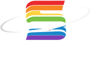

# The missing sensory layer for AI.

**Scentient is building sensory intelligence grounded in human experience, for the agent economy and the future of embodied AI.**

[Explore the Scentient website](https://scentient-inc.github.io/scentient-research/) · [Human experience](https://scentient-inc.github.io/scentient-research/experiences.html) · [Meet Prizm](https://scentient-inc.github.io/scentient-research/prizm.html) · [Alignment research](https://scentient-inc.github.io/scentient-research/alignment.html) · [Contact](mailto:ross@scentient.me)

## Human experience is the starting point

A scent can hold a place, a voice, a texture, and a feeling. We are developing a large-scale multimodal scent-memory episode program connecting scent with language, imagery, sound, spatial context, emotion, and personal meaning.

Our human-facing experience direction lets a person express a memory, explore an atmosphere, refine what fits, and connect that exploration with physical fragrance. The research asks what these experiences can teach intelligent systems.

## Four connected directions

| Direction | Role |
|---|---|
| Human sensory experience | Multimodal scent-memory encounters and useful personal experiences |
| Prizm | A person-facing agent direction and a separate embodied-agent research program |
| Demeter Fragrance Library | The first commercial and physical setting, spanning online and in-store application development |
| Alignment research | Faithful interpretation, uncertainty, correction, continuity, and the relationship between experience and subsequent conduct |

Scentient is the sensory technology and research company. Demeter is the fragrance business. Prizm is not a bottling robot: robotics is one application within the broader embodied research direction.

## Explore the public project

- [Research agenda](RESEARCH.md)
- [AI alignment positioning](ALIGNMENT.md)
- [Benchmark goals and publication status](BENCHMARKS.md)
- [Scentient and Demeter](DEMETER.md)
- [Development goals](ROADMAP.md)
- [Selected demonstrations](DEMONSTRATIONS.md)

## Evidence and publication

This project shares research questions, application directions, selected demonstrations, and milestones. No numerical benchmark result or corpus-size claim is published in this release. Product previews, synthetic tasks, simulation studies, human findings, and physical results are distinct evidence categories.

The company website source in `docs/` is presentation material. Core technology, private human episodes, collection methods, model implementations, and protected evaluation cases are not distributed here.

Ross Crames · Scentient Sensory Technologies · [ross@scentient.me](mailto:ross@scentient.me)
